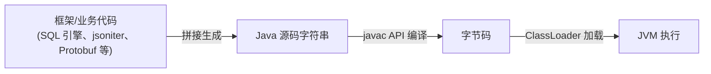

# Java CodeGen 场景 HugeMethod JIT 优化实录：C1 编译器崩溃与"编译不生效"问题排查

## 摘要

基于 SQL 计算引擎、数据序列化（jsoniter、Protobuf、fastjson 等）的 Java 框架普遍使用 CodeGen：在运行时拼接生成 Java 源码，再调用 javac API 编译成字节码加载执行。这类生成代码往往包含一些 **HugeMethod（大方法）**。

HotSpot 默认不即时编译字节码超过 8000 字节的方法，它们只能解释执行。开启 `-XX:-DontCompileHugeMethods` 后，HugeMethod 可以交给 JIT 编译，在高频调用场景下能带来可观的性能收益，但推进过程中会接连遇到两个问题：

1. **JIT 编译器在编译 HugeMethod 时崩溃（SIGSEGV / hs_err）**；
2. **参数开启后编译"未生效"**——方法实际上被编译器跳过（COMPILE SKIPPED），在 JDK 8 上还伴随 C2 编译线程长时间打满 CPU。

本文记录这两个问题的复现、定位与修复过程，并给出可直接使用的 JVM 参数组合。

> **本文关键 JVM 参数**
>
> - 允许编译大方法：`-XX:-DontCompileHugeMethods`
> - 解除 C2 节点数限制（解决 out of nodes 导致的编译跳过）：`-XX:MaxNodeLimit=800000 -XX:NodeLimitFudgeFactor=20000`

## 一、背景：CodeGen 场景与 HugeMethod

常见的 CodeGen 场景主要有两类：

- **SQL 计算引擎的代码生成**：例如批式引擎 Spark、流式引擎 Flink 会把 SQL 通过代码拼接的方式生成 Java 代码；
- **数据解析库的代码生成**：例如 Protobuf、jsoniter、fastjson 等序列化/反序列化库会动态生成专用的编解码代码。

代码生成完成后，框架调用 javac API 将源码编译为字节码，再通过 ClassLoader 加载进 JVM 执行。生成动作可能发生在启动前（静态），也可能发生在运行过程中（动态）。



默认情况下，JVM 不会对字节码大小超过 8000 字节的方法做即时编译（JIT），这些方法只能停留在解释执行。相关选项有两个：

1. `DontCompileHugeMethods`
   - 描述：启用时 JVM 不编译大于 `HugeMethodLimit` 的方法。
   - 类型：boolean，product 选项（可在产品版直接设置）。
   - 默认值：`true`。
2. `HugeMethodLimit`
   - 描述：`DontCompileHugeMethods` 启用时，不参与 JIT 编译的方法字节码上限；关闭 `DontCompileHugeMethods` 后该阈值不再起拦截作用。
   - 类型：intx，**develop 选项**（产品版 JVM 中不可调，只能在 fastdebug 等非产品构建中修改；实际使用中只需切换 `DontCompileHugeMethods`）。
   - 默认值：`8000`。

（相关 HotSpot 源码见附录一。）

这个默认值是一个权衡：HugeMethod 的编译本身复杂且耗时，如果调用频率低，编译的性价比不高；如果调用频率高，编译后的机器码相对解释执行有明显收益。而 CodeGen 场景恰好属于后者——生成的编解码方法通常位于热路径上，调用非常频繁，因此值得打开这道"禁区"。

## 二、问题一：C1 编译 HugeMethod 时 JVM 崩溃

### 2.1 问题现象

团队最初在 Flink SQL 场景试点 `-XX:-DontCompileHugeMethods`，借助 ASM 的 ClassReader 写了个小工具核对方法字节码大小，确认优化目标后灰度上线，取得了不错的性能收益。随后在向数据解析类任务（Protobuf / jsoniter / fastjson）扩大灰度范围时，使用较旧 JDK 8（`1.8.0_131`）的多个作业出现了 JVM 崩溃（SIGSEGV）。灰度一度回滚，部分作业先通过升级 JDK 版本临时规避。

多起崩溃工单的 hs_err 日志高度一致：出错线程都是 **C1 CompilerThread**，崩溃点都在同一个栈帧 `LinearScan::eliminate_spill_moves()`。

```text
#
# A fatal error has been detected by the Java Runtime Environment:
#
#  SIGSEGV (0xb) at pc=0x00007fae16a22047, pid=321457, tid=0x00007fadeb9b5700
#
# JRE version: Java(TM) SE Runtime Environment (8.0_131-b11) (build 1.8.0_131-b11)
# Java VM: Java HotSpot(TM) 64-Bit Server VM (25.131-b11 mixed mode linux-amd64 compressed oops)
# Problematic frame:
# V  [libjvm.so+0x3c4047]  LinearScan::eliminate_spill_moves()+0x1a7
#
```

```text
Current thread (0x00007fae10dbb000):  JavaThread "C1 CompilerThread18" daemon [_thread_in_native, ...]
siginfo: si_signo: 11 (SIGSEGV), si_code: 1 (SEGV_MAPERR), si_addr: 0x0000000100000a3c
```

直接原因是编译器线程访问了 `0x0000000100000a3c` 这个无效地址。完整的原生调用栈如下：

```text
V  [libjvm.so+0x3c4047]  LinearScan::eliminate_spill_moves()+0x1a7
V  [libjvm.so+0x3cc1df]  LinearScan::do_linear_scan()+0x9f
V  [libjvm.so+0x359212]  Compilation::emit_lir()+0x252
V  [libjvm.so+0x35a11b]  Compilation::compile_java_method()+0xdb
V  [libjvm.so+0x35a1de]  Compilation::compile_method()+0x4e
V  [libjvm.so+0x35a54e]  Compilation::Compilation(AbstractCompiler*, ciEnv*, ciMethod*, int, BufferBlob*)+0x25e
V  [libjvm.so+0x35b2f9]  Compiler::compile_method(ciEnv*, ciMethod*, int)+0xa9
V  [libjvm.so+0x4b0aea]  CompileBroker::invoke_compiler_on_method(CompileTask*)+0xc9a
V  [libjvm.so+0x4b1a96]  CompileBroker::compiler_thread_loop()+0x5d6
V  [libjvm.so+0xa7697c]  JavaThread::run()+0x11c
V  [libjvm.so+0x927568]  java_start(Thread*)+0x108
C  [libpthread.so.0+0x74a4]  start_thread+0xc4

Current CompileTask:
C1:  34715 9965   3   jsoniter_codegen.cfgXXXX.decoder.com.example.json.event.LogEvent::decode_ (8726 bytes)
```

| 项目 | 内容 | 说明 |
|---|---|---|
| 编译器 | C1（Client Compiler） | 编译速度与代码质量之间取平衡的 JIT 编译器（见附录二） |
| 编译对象 | jsoniter 生成的 `LogEvent::decode_`（8726 字节） | 已超过 8000 字节阈值，属于 HugeMethod |
| 编译阶段 | `LinearScan::eliminate_spill_moves()` / `do_linear_scan()` | C1 的线性扫描寄存器分配阶段，`eliminate_spill_moves` 负责消除寄存器与栈之间多余的 move 指令 |

### 2.2 业务 CodeGen 场景分析与最小复现

崩溃时正在编译的 `decode_` 是 jsoniter 为某个业务 POJO（下文中统一化名为 `com.example.json.event.LogEvent`，实际类约含 400 个字段）动态生成的专用 JSON 解码器。jsoniter 的动态代码生成基于 javassist，可参考其官方文档：<https://jsoniter.com/java-features.html#dynamic-code-generation>。

JSON 解码即反序列化：`decode_` 把 JSON 字符串还原成 POJO 实例：

```mermaid
flowchart LR
    S['{"id": 308291, "name": "HelloEvent"}'] -->|decode_(iter)| O["LogEvent 实例<br/>id = 308291<br/>name = HelloEvent"]
```

POJO 字段多达约 400 个，意味着解码器 `decode_` 必然是一个 HugeMethod，开启 `-XX:-DontCompileHugeMethods` 后一定会触发它的 JIT 编译。为了直观看到生成代码，我们搭建了一个最小复现工程（设置 `JSONITER_DEBUG=true` 环境变量即可让 jsoniter 打印生成的源码）。`decode_` 的逻辑可提炼为三步：

```java
public static Object decode_(com.jsoniter.JsonIterator iter) throws IOException {
    // ... 准备工作，例如定位到首个 '{'
    // 步骤 1：为每个字段初始化一个临时变量
    Object _user_   = null;
    Object _req_id_ = null;
    Object _label_  = null;
    // ... 约 400 个临时变量

    // 步骤 2：读取 key 的 hash，switch 分派并给对应临时变量赋值
    do {
        switch (com.jsoniter.CodegenAccess.readObjectFieldAsHash(iter)) {
            case -2144446351:
                _valid_external_actions_ = iter.read();
                continue;
            case -2129982970:
                _psa_carousel_spu_ids_ = iter.read();
                continue;
            // ... 约 400 个 case
        }
        iter.skip();
    } while (com.jsoniter.CodegenAccess.nextTokenIsComma(iter)); // 读到 '}' 为止

    // 步骤 3：new 出对象并逐字段赋值
    LogEvent obj = existingObj == null ? new LogEvent() : (LogEvent) existingObj;
    obj.user = _user_;
    obj.req_id = _req_id_;
    obj.label = _label_;
    // ... 约 400 个字段赋值
    return obj;
}
```

复现工程的 Main 类循环调用 20 万次 `JsonIterator.deserialize(jsonString, LogEvent.class)` 以触发 JIT 编译。在 `1.8.0_131` 以及我们当时使用的 JDK 8 更新线上，都稳定复现了相同的崩溃栈：

```text
V  [libjvm.so+0x3c4043]  LinearScan::eliminate_spill_moves()+0x1a3
V  [libjvm.so+0x3cc1df]  LinearScan::do_linear_scan()+0x9f
V  [libjvm.so+0x359212]  Compilation::emit_lir()+0x252
...
Current CompileTask:
C1:   5963 1226   3   jsoniter_codegen.cfgXXXX.decoder.com.example.json.event.LogEvent::decode_ (12335 bytes)
```

此时可以合理猜测：`decode_` 中约 400 个临时变量导致虚拟寄存器数量暴涨，线性扫描在处理大量寄存器溢出（register spill）时触发了 C1 的缺陷。

### 2.3 定位：hs_err 反汇编与社区 Issue

#### 反汇编崩溃点

hs_err 中记录了崩溃处的机器指令：

```text
Instructions: (pc=0x00007fae16a22047)
0x00007fae16a22037:   40 08 48 8b 51 58 48 c1 f8 0e 48 98 48 8b 04 c2
0x00007fae16a22047:   83 78 3c 27 7e ab 48 8b 40 58 8b 80 88 00 00 00
```

反汇编并对照寄存器现场：

```asm
  3c402e:  mov    -0xb8(%rbp),%rcx
  3c4035:  mov    0x8(%rax),%rax
  3c4039:  mov    0x58(%rcx),%rdx
  3c403d:  sar    $0xe,%rax
  3c4041:  cltq
  3c4043:  mov    (%rdx,%rax,8),%rax
  3c4047:  cmpl   $0x27,0x3c(%rax)     ; <-- pc，崩溃指令
  3c404b:  jle    ...
```

```text
RAX=0x0000000100000a00 is an unknown value
RDX=0x00007fadf7adf510 is an unknown value
```

崩溃指令访问 `0x3c(%rax)`，而 `RAX=0x0000000100000a00`，故 `si_addr = 0x100000a3c = RAX + 0x3c`——RAX 里是一个非法指针，它由上一条 `mov (%rdx,%rax,8),%rax` 从 RDX 指向的数组中取出。再向上溯源涉及编译器内部数据结构，而旧版 Oracle JDK 8 闭源、无法用 addr2line 对应到源码，纯汇编方向暂时走不下去。

#### 柳暗花明：对上社区 Issue

OpenJDK 8 的源码是公开的。由于升级到 JDK 11 可以规避问题，我们重点比对了 JDK 11 中 C1 的相关修复，很快锁定了高度相似的 Issue：

**[JDK-8261235: C1 compilation fails with assert(res->vreg_number() == index) failed: conversion check](https://bugs.openjdk.org/browse/JDK-8261235)**

报告者在开发 Java 代理时遇到了 C1 崩溃，邮件列表中给出的栈与我们的现场几乎一致，且他在 fastdebug 构建中触发的是 `MoveResolver::insert_move` 处的断言失败（release 构建中断言被裁掉，表现为野指针 SIGSEGV）：

> <https://mail.openjdk.org/pipermail/hotspot-compiler-dev/2021-February/044006.html>

### 2.4 复现与确认

利用 Issue 自带的 jtreg 用例可以在不依赖业务代码的情况下复现：

1. 以 fastdebug 级别构建 OpenJDK 8（fastdebug 会保留 assert，能暴露 release 版中表现为崩溃的问题）：

   ```bash
   bash ./configure \
       --with-debug-level=fastdebug \
       --with-native-debug-symbols=internal \
       --with-boot-jdk="$BOOT_JDK8"
   make images
   ```

2. 取社区 PR 中的测试用例（<https://github.com/openjdk/jdk/pull/2543>），放入 `hotspot/test/compiler/c1/`：

   ```text
   hotspot/test/compiler/c1/TestTooManyVirtualRegisters.jasm
   hotspot/test/compiler/c1/TestTooManyVirtualRegistersMain.java
   ```

3. 用 jtreg 分别在不同 JDK 上执行：

   ```bash
   jtreg -jdk "$JDK8_131_HOME"      compiler/c1/TestTooManyVirtualRegistersMain.java
   jtreg -jdk "$JDK8_RELEASE_HOME"  compiler/c1/TestTooManyVirtualRegistersMain.java
   jtreg -jdk "$JDK8_FASTDEBUG_HOME" compiler/c1/TestTooManyVirtualRegistersMain.java
   ```

结果：

- 旧 JDK 8（`1.8.0_131`）和未打补丁的 JDK 8 release 构建：复现出与业务现场相同的 `LinearScan::eliminate_spill_moves()` 崩溃栈；
- JDK 8 fastdebug 构建：复现出与社区完全相同的断言——`assert(res->vreg_number() == index) failed: conversion check`（位于 `c1_LIR.hpp`）。

至此可以确认，这就是 JDK-8261235。

> **版本提示**：该缺陷在主线 JDK 17 修复，并回合到 11.0.12；OpenJDK 8u 的官方回合较晚（openjdk8u502，见 JDK-8382078）。使用较早 JDK 8 发行版的团队需要自行确认发行版是否已包含该补丁。

### 2.5 根因与修复

C1 使用**线性扫描（Linear Scan）**进行寄存器分配：以变量的生命周期（live interval）为目标，在线性遍历控制流的过程中分配物理寄存器，寄存器不够时把部分值溢出（spill）到栈上。jsoniter 生成的方法极大、临时变量极多，虚拟寄存器数量超出了旧实现的处理范围，溢出处理逻辑中产生了错误的虚拟寄存器编号映射，最终导致：

- release 构建：访问非法地址，JVM 崩溃；
- fastdebug 构建：`vreg_number()` 转换断言失败。

社区修复的思路是**防御性兜底**：在进入线性扫描前检查虚拟寄存器数量，一旦超过上限（vreg max），直接放弃本次编译并把该编译任务标记为失败、退回更低/更高层级重试，而不是带着非法状态继续执行。

我们把社区补丁回合到了团队维护的 JDK 8 分支（社区 PR：<https://github.com/openjdk/jdk/pull/2543>，8u 版本见 <https://github.com/openjdk/jdk8u-dev/pull/622>）。

补充一点线性扫描背景，便于理解崩溃位置：

- **遍历与分析**：从方法入口按控制流顺序线性扫描，分析每条指令的寄存器使用与变量生命周期；
- **寄存器分配**：根据活跃范围为变量挑选物理寄存器，无空闲寄存器时选择当前值溢出到栈，腾出寄存器；
- **冲突处理**：多个变量竞争同一寄存器时，依据活跃范围等因素决定溢出对象，降低访存开销。

### 2.6 业务验证

在携带补丁的 JDK 8 构建上重新运行复现工程（循环 20 万次反序列化）：

- 旧版 JDK 8 与未修复构建：必现崩溃；
- 回合补丁后的 JDK 8：不再崩溃，编译器改为跳过该方法的 C1 编译并继续运行（日志见第三节，这正是修复后的预期行为）；
- JDK 11（≥ 11.0.12）/ 17 / 21：均不崩溃。

崩溃问题就此解决。但"不崩溃"不等于"优化生效"——紧接着我们发现 HugeMethod 实际上并没有被成功编译。

## 三、问题二：HugeMethod 编译"未生效"

### 3.1 编译日志中的两次 COMPILE SKIPPED

保持 `-XX:-DontCompileHugeMethods`，再加 `-XX:+PrintCompilation` 观察编译过程：

```bash
java -XX:-DontCompileHugeMethods -XX:+PrintCompilation \
     -jar big-method-repro.jar | grep decode_
```

```text
 444 1385  3  jsoniter_codegen.cfgXXXX.decoder.com.example.json.event.LogEvent::decode_ (12335 bytes)
5875 1385  3  jsoniter_codegen.cfgXXXX.decoder.com.example.json.event.LogEvent::decode_ (12335 bytes)  COMPILE SKIPPED: out of virtual registers in linear scan (retry at different tier)
5876 1429  4  jsoniter_codegen.cfgXXXX.decoder.com.example.json.event.LogEvent::decode_ (12335 bytes)
5896 1429  4  jsoniter_codegen.cfgXXXX.decoder.com.example.json.event.LogEvent::decode_ (12335 bytes)  COMPILE SKIPPED: out of nodes parsing method (retry at different tier)
```

> `-XX:+PrintCompilation` 每行格式为：`<时间戳> <编译任务ID> <编译级别(0~4)> <方法名>(<字节码大小>) <附加信息>`。也可以用 `jcmd <pid> Compiler.queue` 查看编译队列（JDK 8 的 jcmd 不支持 `Compiler.codelist`，该子命令需 JDK 11+）。
>
> JDK 11/17 上运行 jsoniter 还需加 `--add-opens java.base/java.lang=ALL-UNNAMED` 等开放参数。

简单回顾分层编译（详见附录二）：方法先由解释器执行（level 0），再经 C1 的 level 1~3，最后热点方法由 C2 编译到 level 4。日志里发生了两次跳过：

1. **第一次（C1，level 3）**：任务 1385 编译失败，原因 `out of virtual registers in linear scan`——这正是 JDK-8261235 补丁的兜底路径：虚拟寄存器超限，安全放弃 C1 编译并转其他层级重试。**属于预期行为**。
2. **第二次（C2，level 4）**：任务 1429 又以 `out of nodes parsing method` 失败，C2 也拒绝编译。

两次跳过后，`decode_` 只能继续解释执行。用 `jcmd <pid> Compiler.codelist`（JDK 11+）查看 Code Cache 也确认其中没有该方法。

此外在 JDK 8 上还有一个附带现象：C2 要经过很长时间（5 分钟以上）才抛出 out of nodes，期间编译线程 CPU 打满。下面分别处理。

### 3.2 C1 跳过：预期行为，无需处理

`out of virtual registers in linear scan` 是修复后的保护动作：C1 放弃编译后会提示 `retry at different tier`，编译任务可以上提到 C2。因此真正需要解决的是 C2 为什么也不编译。

### 3.3 C2 的 "out of nodes" 与参数调优

C2 使用 **Sea of Nodes** 作为中间表示：解析字节码时不断生成 Node，并在编译过程中持续膨胀。HotSpot 用两个产品参数限制 Node 规模，防止编译器在病态方法上耗尽资源：

- `MaxNodeLimit`（默认 **80000**）：一次 C2 编译允许的最大 Node 数；
- `NodeLimitFudgeFactor`（默认 **2000**）：为解析阶段**之后**的优化阶段预留的 Node 膨胀余量（fudge factor）。

解析字节码过程中会调用 `Compile::check_node_count` 检查，逻辑等价于：

```cpp
// 简化表达：live_nodes 为当前活跃 Node 数
if (live_nodes + NodeLimitFudgeFactor * 5 <= MaxNodeLimit) {
    // 允许继续解析
} else {
    record_method_not_compilable("out of nodes parsing method");
}
```

CodeGen 产生的 HugeMethod 活跃 Node 远超普通方法，默认预算下检查失败，于是编译被跳过。

**调参方向**（这里需要纠正一个常见误解）：

`NodeLimitFudgeFactor` 不是越小越好。它是为解析之后的优化阶段预留的安全余量——如果一味调小，解析阶段的检查虽然容易通过，但后续优化阶段 Node 继续膨胀时可能触发更晚的 `out of nodes` 失败，甚至编译出半截又被丢弃。合理做法是**把两个预算等比例放大**，保持余量占比不变。

约束条件：JVM 启动时会校验 `NodeLimitFudgeFactor` 必须落在 `MaxNodeLimit` 的 2%~40% 之间，否则直接启动失败。默认组合 80000 / 2000 的比例是 2.5%，因此我们将两者同时放大 10 倍：

```bash
-XX:MaxNodeLimit=800000 -XX:NodeLimitFudgeFactor=20000
```

调整后再次观察：PrintCompilation 中 C2 编译成功，`Compiler.codelist` 中也能找到 `decode_`，编译产物进入 Code Cache。

**代价提示**：放大 Node 预算意味着单次 C2 编译会消耗更多内存和编译线程时间。该参数组合建议只在确实存在高频 HugeMethod 的进程上开启，并关注编译线程 CPU 与 Code Cache 占用（可配合 `-XX:ReservedCodeCacheSize` 评估）。

### 3.4 JDK 8 上 C2 编译线程长时间打满 CPU

在 JDK 11/17 上上述参数已经让优化生效，但目标业务运行在 JDK 8：`decode_` 在被 C2 编译的几分钟内，编译线程持续 100% CPU：

```text
    PID USER      PR  NI    VIRT    RES    SHR S %CPU %MEM     TIME+ COMMAND
2306308 user      20   0 36.9g   620080  16288 R 99.9  0.1   0:34.14 C2 CompilerThre
2306240 user      20   0 36.9g   620080  16288 R 99.3  0.1   0:34.34 java
```

在多个 JDK 版本上二分后发现：**JDK 10 的最新更新版本仍可复现，而 JDK 11 GA（b11）起不复现**。排查 JDK 10 → 11 之间的 C2 变更，定位到：

**[JDK-8200303: C2 should leverage profiling for lookupswitch/tableswitch](https://bugs.openjdk.org/browse/JDK-8200303)**（JDK 11 b11 修复，影响 8/11）

该 Enhancement 引入了特性开关 `UseSwitchProfiling`：让 C2 利用解释器/C1 收集的 switch 分支 profile，避免对超大 `lookupswitch/tableswitch`（jsoniter 生成的约 400 个 case 正是典型）做指数级膨胀的保守优化。

反向验证：在 JDK 11/17 上显式关闭该特性（`-XX:-UseSwitchProfiling`），C2 长编译、CPU 打满的现象重新出现，证明因果关系成立。随后我们将 `UseSwitchProfiling` 特性回移到团队维护的 JDK 8 分支，基于新构建验证：业务场景下 C2 编译时间恢复正常，不再出现编译线程长时间打满。

> 对无法自行回移补丁的 JDK 8 用户，临时缓解思路是避免让 C2 编译这类巨型 switch 方法（例如先不开启 `-XX:-DontCompileHugeMethods`，或配合分层编译级别限制做灰度观察）；根治仍需补丁。

## 四、小结

CodeGen 场景下让 HugeMethod 重新进入 JIT 编译，收益明确，但要跨三道坎：

| 关卡 | 现象 | 根因 | 对策 |
|---|---|---|---|
| 1 | C1 编译 HugeMethod 时 SIGSEGV | 虚拟寄存器超限，C1 线性扫描溢出处理缺陷（[JDK-8261235](https://bugs.openjdk.org/browse/JDK-8261235)） | 回合补丁；高版本（17 / 11.0.12+ / 8u502+）已修复 |
| 2 | C2 `COMPILE SKIPPED: out of nodes parsing method` | Sea of Nodes 的 Node 预算对 HugeMethod 不足 | `-XX:MaxNodeLimit=800000 -XX:NodeLimitFudgeFactor=20000`（等比放大，勿盲目缩小 fudge factor） |
| 3 | JDK 8 上 C2 编译线程长时间 100% CPU | C2 对巨型 switch 的优化缺少 profile 引导（[JDK-8200303](https://bugs.openjdk.org/browse/JDK-8200303)，`UseSwitchProfiling`） | 回移特性补丁，或升级到 JDK 11+ |

推荐的最终参数组合（确认 JDK 已包含关卡 1、3 的补丁后使用）：

```bash
-XX:-DontCompileHugeMethods
-XX:MaxNodeLimit=800000
-XX:NodeLimitFudgeFactor=20000
```

排查这类问题的通用方法也值得沉淀：以 hs_err 的 `Current CompileTask` 和原生栈为切入点定位"编译器 + 编译阶段 + 编译对象"三要素；用 `-XX:+PrintCompilation` 与 `jcmd Compiler.*` 观察编译决策；用最小复现工程 + 社区 jtreg 用例对齐上游 Issue；fastdebug 构建中的 assert 往往比 release 版的野指针崩溃直指根因。另外，这次涉及的两个缺陷在高版本 JDK 中均已修复，条件允许时升级到更新的 LTS 版本始终是更省心的选择。

## 附录一：HugeMethod 相关选项源码

```cpp
product(bool, DontCompileHugeMethods, true,
        "Do not compile methods > HugeMethodLimit")

develop(intx, HugeMethodLimit, 8000,
        "Don't compile methods larger than this if "
        "+DontCompileHugeMethods")
```

编译策略中的拦截逻辑：

```cpp
// Returns true if m is allowed to be compiled
bool CompilationPolicy::can_be_compiled(methodHandle m, int comp_level) {
  // allow any levels for WhiteBox
  assert(WhiteBoxAPI || comp_level == CompLevel_all || is_compile(comp_level), "illegal compilation level");

  if (m->is_abstract()) return false;
  if (DontCompileHugeMethods && m->code_size() > HugeMethodLimit) return false;
  // ...
}
```

## 附录二：JVM 执行引擎与分层编译

Java 方法最初由解释器逐条执行字节码模板，只有热点方法才会触发 JIT 编译。由于多数类在解释执行期间已完成加载，编译时可以获得更完整的类型信息，支持更激进的内联与优化。若方法包含长时间运行的循环，即使调用次数不高，回边（backedge）计数达到阈值后也会在运行中途从解释执行切换为编译代码执行，即 **OSR（On Stack Replacement，栈上替换）**。

分层编译（Tiered Compilation）共 5 个级别：

| Tier | 组件 | 说明 | Code Cache 段 |
|---|---|---|---|
| 0 | 解释器 | 解释执行，统计方法调用与回边次数 | — |
| 1 | C1 | 简单编译，不收集 profile | non-profiled nmethods |
| 2 | C1 | 带方法调用/回边计数的编译 | profiled nmethods |
| 3 | C1 | 完整 profile 收集 | profiled nmethods |
| 4 | C2 | 全优化编译 | non-profiled nmethods |

> 执行引擎分层示意可参考 HotSpot Client Compiler 论文：*Design of the Java HotSpot™ client compiler for Java 6*，<https://dl.acm.org/doi/10.1145/1369396.1370017>；分层级别表整理自 JITWatch 文档，<https://github.com/AdoptOpenJDK/jitwatch>。

关于分层编译的两个参数，网上有一处常见误传需要澄清：

- `-XX:-TieredCompilation`：**关闭**分层编译。此时在 server 模式下方法不再经过 C1 层级，满足阈值后直接由 C2 编译；该模式下 `TieredStopAtLevel` 不生效。
- `-XX:TieredStopAtLevel=<n>`：在**保持分层编译开启**的前提下限制最高编译级别，例如 `-XX:TieredStopAtLevel=3` 表示只用 C1、不进入 C2。

因此 `-XX:-TieredCompilation -XX:TieredStopAtLevel=4` 这种写法是自相矛盾的（关掉分层后后者已无意义），需要"只用 C2"时直接使用 `-XX:-TieredCompilation`（server VM 默认即 C2），需要"最高只到某一层"时保留默认的 `+TieredCompilation` 再设置 `TieredStopAtLevel`。

---

## 参考链接

- JDK-8261235（C1 虚拟寄存器溢出崩溃）：<https://bugs.openjdk.org/browse/JDK-8261235>
- 报告邮件：<https://mail.openjdk.org/pipermail/hotspot-compiler-dev/2021-February/044006.html>
- 社区修复 PR：<https://github.com/openjdk/jdk/pull/2543>；8u 版本：<https://github.com/openjdk/jdk8u-dev/pull/622>
- JDK-8200303（C2 switch profiling，引入 `UseSwitchProfiling`）：<https://bugs.openjdk.org/browse/JDK-8200303>
- jsoniter 动态代码生成：<https://jsoniter.com/java-features.html#dynamic-code-generation>
